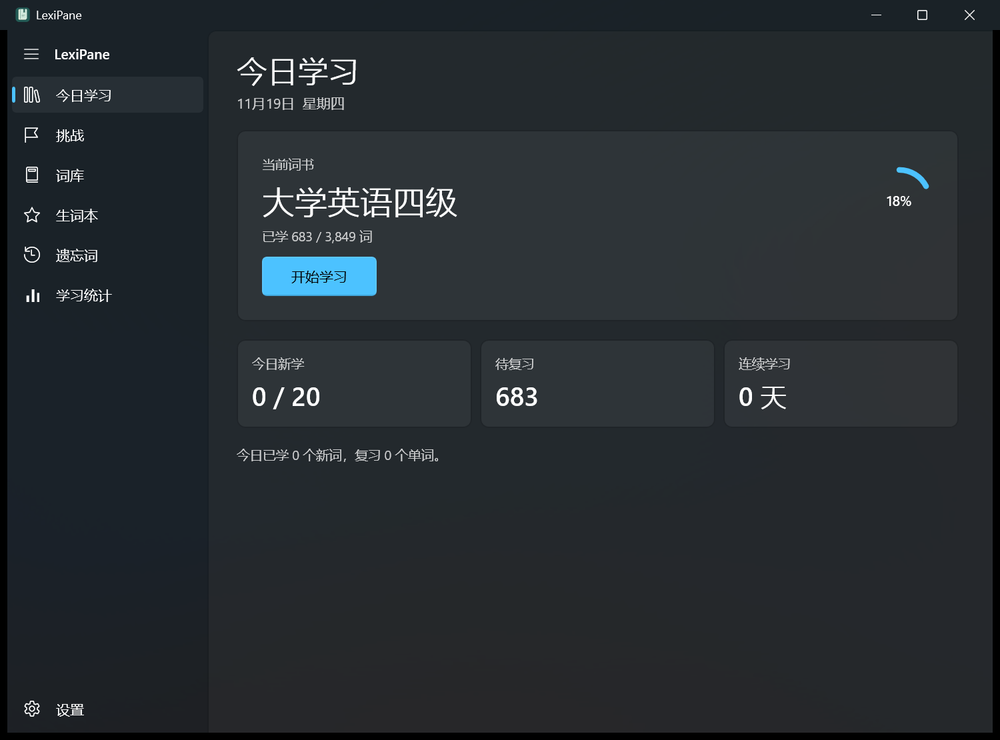
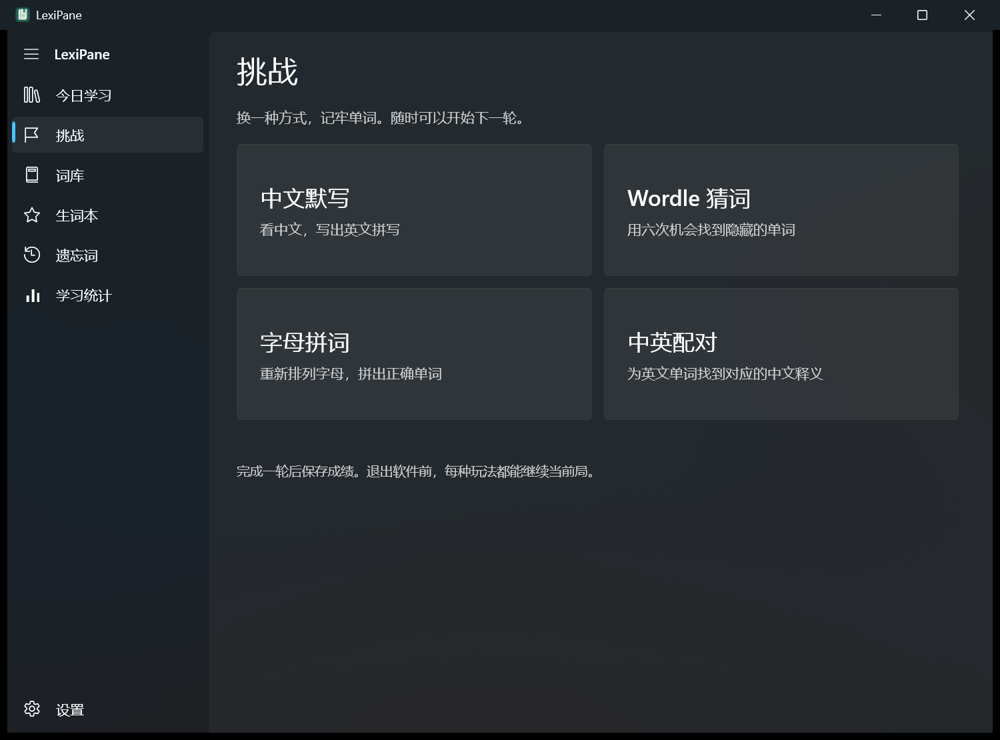
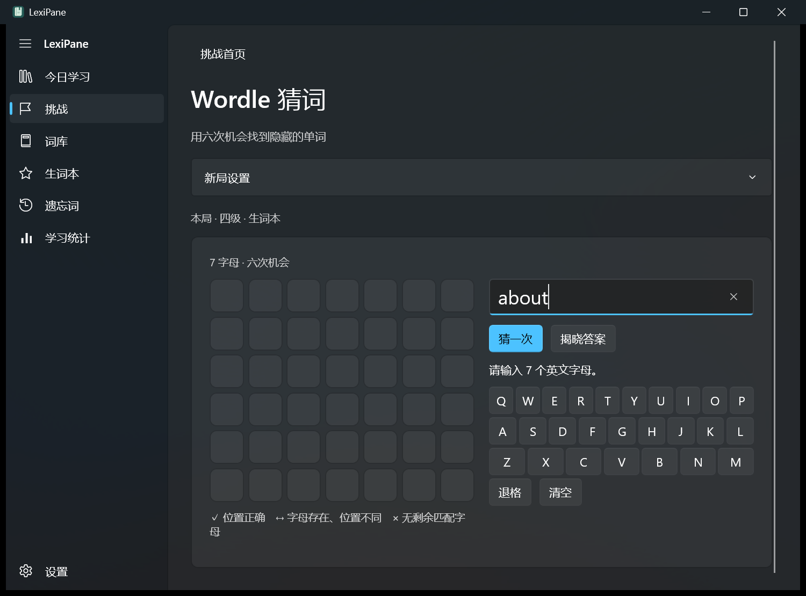
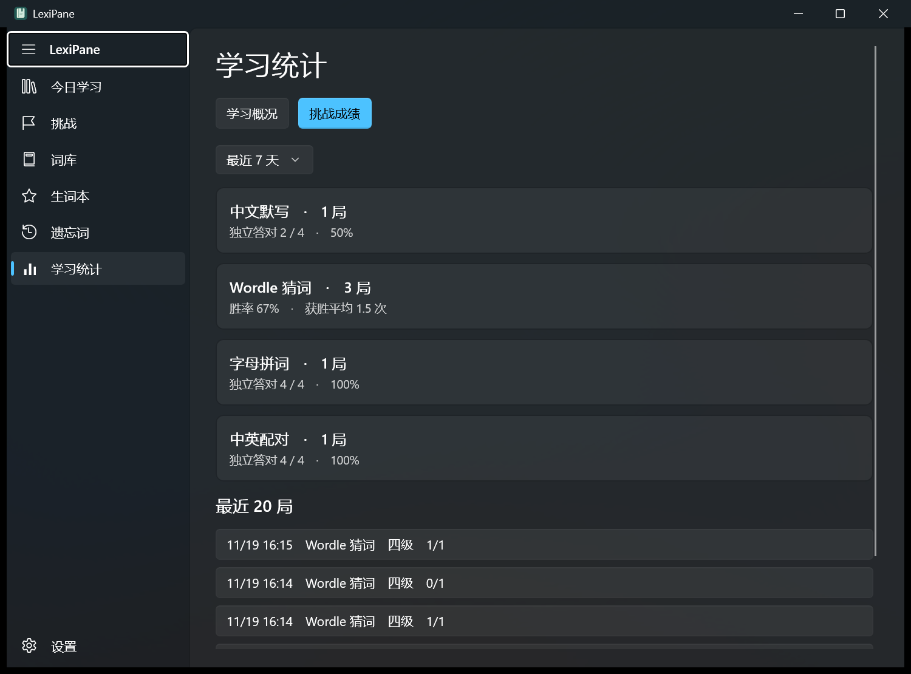

# LexiPane 2.3.1

LexiPane 是一款 Windows 原生离线词汇学习应用，支持 Windows 11 x64 21H2（22000）及更新版本。解压整个 `LexiPane-v2.3.1-windows-x64-portable.zip`，双击文件夹中的 **LexiPane.exe**。词库、.NET 和 WinUI 运行时随程序提供。

## 下载

<a href="https://apps.microsoft.com/detail/9NFDCL5RBCRG?hl=zh-cn&amp;gl=CN&amp;ocid=pdpshare">
  
</a>

[下载 Windows 11 x64 免安装版](https://github.com/FFZFC/vocabulary/releases/download/v2.3.1/LexiPane-v2.3.1-windows-x64-portable.zip) · [版本说明与源码](https://github.com/FFZFC/vocabulary/releases/tag/v2.3.1)

## 功能

- 透明桌面单词卡与主窗口同步，支持托盘、撤销、生词本和笔记。
- 内置四六级词库，提供到期复习、每日目标提示和学习统计。
- 中文默写、4—7 字母 Wordle、字母拼词与中英配对，支持错词重练和挑战成绩。
- 在「设置 → 学习数据」导入和导出备份，可在升级或换电脑时恢复学习记录。
- 离线使用，跟随 Windows 系统主题与高对比度设置。

## 界面预览









[查看默写界面](docs/images/dictation.png) · [查看配对界面](docs/images/matching.png) · [查看桌面卡片](docs/images/goal-widget.png)

## 开始使用

首次启动选择词书和每日新词目标，默认四级、每天目标 20 词。从“今日学习”进入单词卡，主窗口与桌面小窗共享进度。每日目标用于提示进度，达到目标后自动进入下一词，可以持续学习。主窗口和小窗都会显示实际进度，例如“今日新学 25 / 20”，并提示“今日目标已达成，可继续学习”。

| 点击 | 接下来会发生什么 |
|---|---|
| 记得 | 保存评分，直接进入下一词 |
| 不记得 | 立即记录遗忘，显示释义，10 分钟后安排复习。读完点“下一词” |
| 查看释义 | 仅查阅，点“下一词”后本轮跳过，保留原有学习记录和复习安排 |

在学习区使用数字 **1** 选择记得，**2** 选择不记得，**空格** 查看释义或继续。卡片顶部的撤销按钮可以恢复本轮最近一次评分前的状态。开始新轮、换词书、跨日或退出程序时清除撤销记录。

“遗忘词”列出当前词书最近一次评分为不记得的词，支持搜索和专项练习。再次记得后自动移出。学习统计可切换近 7 天或 30 天，查看新学／复习量和记得率。12 周热力图按每天实际评分的不同词条数着色。悬停查看数值，也可用 Tab 聚焦图表后按方向键查看日期。统计根据所有词书的实际评分计算，旧版 3、4、5 分都计为记得。

按 **Win+D** 可在桌面卡片中继续同一张词卡。拖动卡片顶部可移动，拖动边缘可调整大小。卡片右上角按钮会隐藏卡片。主窗口关闭时收起到托盘，单击托盘图标恢复主窗口，右键菜单可切换卡片或彻底退出。设置中可以换词书、改每日目标、开关卡片和实时调整毛玻璃浓度。Windows 开启透明效果时，小窗失去焦点仍保持毛玻璃。

学习按“到期复习优先，再取未学新词”推进。单独查看释义后，本轮暂时跳过该词。有效候选全部被浏览后显示“本轮已浏览完”，可开始新一轮。当前词书新词已经学完且没有到期复习时，会显示相应状态。

“词库”支持中英文搜索，可按词书和学习状态筛选，点击结果查看完整释义。切换词书会保留共同词条的学习记录。

## 生词本与笔记

点击主窗口或小窗词卡上的 **☆**，即可把当前词收入生词本。也可以打开词库中的词条，点击“加入生词本”。收藏会在两个窗口同步，学习仍停留在当前词卡。生词本按当前词书显示收藏，最近加入的排在前面。

在词条详情的“我的笔记”写下联想或易混词，点击“保存笔记”。之后在词卡上打开释义，两扇窗口都能看到这条笔记。生词本支持按英文、释义和笔记内容搜索。移出收藏后，笔记与评分记录仍能从词库查看。

点击“练习生词本”即可从最近收藏的词开始。每轮按当前词书练习，每个词出现一次。记得与不记得按日常学习规则评分，查阅后点“下一词”则中性跳过。本轮结束可以再学一轮，也可以返回日常学习。搜索只筛选列表，练习范围是当前词书中的全部收藏。

词条详情还会显示下次复习时间和评分总次数。展开“学习记录”可查看最近五次评分的时间、属于新学或复习、以及评分结果。

## 默写挑战与小游戏

从左侧“挑战”进入中文默写、Wordle 猜词、字母拼词和中英配对。默认使用当前词书，也可选择已学词、生词本或遗忘词。每轮 10 或 20 词，范围不足时按实际词数出题。可以随时开始下一轮。

- **中文默写**显示中文释义、词性和字母数量。输入英文后按 Enter 或点击“提交答案”，忽略大小写和首尾空格。提示首字母后答对记为提示完成。查看答案和跳过记为未独立答对。
- **Wordle**可选 4、5、6、7 字母，默认 5 字母，每局六次机会。输入后按 Enter 或“猜一次”。✓ 表示位置正确，↔ 表示字母存在但位置不同，× 表示没有剩余匹配字母。无效词和重复猜测保留机会，揭晓答案结束本局。
- **字母拼词**支持点击字母块或键盘输入，使用全部给出的字母组成单词后提交。可退格、清空或提示下一个正确字母。
- **中英配对**先选英文，再选对应的中文释义。每屏最多五对，配错可继续。准确率按每个英文词首次配对是否成功计算。

提交后进入答案页，点击“下一题”继续。结束时可查看成绩、收藏、打开词条详情，或重练未独立答对的词。挑战成绩在“学习统计”的“挑战成绩”中查看，按玩法展示近 7／30 天表现和最近 20 局详情。默写、拼词和配对的独立答对率以首次无提示答对词数除以本轮总词数计算，Wordle 展示胜率与获胜平均猜测次数。

每种玩法在本次运行内保留一局。切换页面或将主窗口收起到托盘后可继续，彻底退出后未完成局重新开始。完成整轮后事务保存成绩。挑战独立计分，日常学习卡片负责提交复习评分。

Wordle 猜测词典包含 **19,649** 个词，4／5／6／7 字母分别为 2,754／4,173／5,874／6,848。使用同一固定版本 ECDICT 中具考试标签、有效词频或 Collins 标记的纯小写词条，并包含所有符合长度的四六级答案。来源和校验值位于发布包的 `Data/wordle-source.json`。运行 `python tools/build_challenge_dictionary.py` 可从已缓存且通过校验的 ECDICT 源文件重建。

## 词库与存档

四级收录 **3,849** 词，六级收录 **5,805** 词（包含四级基础）。按 ECDICT 的 cet4、cet6 整词标签筛选，并按规范化拼写去重。数据固定在提交 `39cfb9672c0906b63569e0453c2e6abfb9ab182a`。收录量指本软件内置词书的实际词条数。词频优先取 frq，其次取 bnc，缺失词频排在末尾。来源、校验值和许可位于发布包的 `Data` 目录。[ECDICT 项目](https://github.com/skywind3000/ECDICT/tree/39cfb9672c0906b63569e0453c2e6abfb9ab182a)

便携版的学习进度、笔记、收藏、挑战成绩、设置和卡片位置保存在 `%LocalAppData%\Vocabulary\study.db`。升级便携版时，先从旧版托盘菜单退出，再将新版完整解压到另一个文件夹并运行。新版会继续读取该存档。早于 2.2 的存档会按现有迁移机制备份并升级。

2.3.1 可在「设置 → 学习数据」导出 `.lexipane` 备份，也可导入该备份或旧版 `study.db`。导入会替换当前存档，程序会先自动备份原有数据。导入成功后重新打开 LexiPane 即可继续学习。

## 从源码构建

使用 Windows 11 x64、.NET 10 SDK、Windows SDK 10.0.26100，以及含 x64 VC++ 可再分发运行库的 Visual Studio 2026。可打开 `Vocabulary.slnx`，或在项目根目录执行以下命令。首次还原依赖需要网络，内置词库已经生成。

```powershell
dotnet run --project tests/Vocabulary.Checks -- src/Vocabulary/Data/lexicon.db
powershell -ExecutionPolicy Bypass -File tools/publish.ps1
```

上述命令生成 `artifacts/LexiPane-v2.3.1-windows-x64-portable.zip`。使用 WinUI 3、Windows App SDK 2.6.5、.NET 10 及 Windows 内置 SQLite 引擎。学习逻辑和数据访问位于 Vocabulary.Core，WinUI 界面及桌面集成位于 Vocabulary。评分日志和词条进度在同一笔事务中提交，每张卡片有独立提交标识。复习间隔和难度系数依据 [SM-2](https://www.super-memory.com/english/ol/sm2.htm)。

需要重新生成词库时运行 `python tools/build_lexicon.py`。脚本校验固定源文件的 SHA-256 后生成 SQLite 词库。图标原图生成脚本为 `tools/make_icon.py`，需要 Pillow。

## 验收

`tools/desktop_check.ps1` 通过 Windows UI Automation 和 Win32 操作实际发布包。它使用独立的模拟学习记录，验证统计图、遗忘词、撤销和背景透光，也覆盖首次启动、双语搜索、跨窗口评分、单实例、Win+D、拖动、托盘和重新启动。请在项目根目录启动 Windows PowerShell 运行：

```powershell
powershell -ExecutionPolicy Bypass -File tools/desktop_check.ps1 -AppExe artifacts/LexiPane-v2.3.1-windows-x64-portable/LexiPane.exe
```

给上面的命令加 `-GoalOnly` 可检查目标为 1 时持续切词、超额进度、同步撤销和重启。加 `-NotebookOnly` 可检查两窗收藏、编辑与搜索笔记、词条记录、生词本练习和重启后的保存结果。两个模式都使用独立空白存档。

`-SystemChecks` 会临时变更当前显示器缩放、明暗主题和高对比度，再重启 Explorer，适合在专门的交互测试时段运行。桌面验收需要 Python、Pillow 和 pywin32。测试期间自动记录并恢复显示设置。测试入口 `VOCABULARY_TEST_DATA` 用于隔离测试存档和应用实例。

2.3.1 的 106 项核心检查已通过，包含旧存档导入、导入前自动备份及失败回滚。桌面卡片、四种挑战、显示设置和断网运行的完整桌面验收在 2.3.0 完成。截图来自实际发布程序。

运行 `python tools/check_offline.py` 可在无网络能力的临时 Windows AppContainer 中验证首次启动、查词和学习进度。该脚本从发布 ZIP 提取独立的测试副本，并在结束后清理临时身份。

挑战专项验收使用独立的旧版测试存档，给上面的桌面验收命令加 `-ChallengeOnly`。

挑战专项模式配合 `-SystemChecks` 时，会临时切换主题、高对比度和缩放，并自动恢复原设置。

## 参与开发

欢迎通过 [Issues](https://github.com/FFZFC/vocabulary/issues) 提交建议或问题，也欢迎 [Pull Requests](https://github.com/FFZFC/vocabulary/pulls)。本地构建后可运行上述核心检查。报告桌面卡片问题时，请注明 Windows 版本、显示器缩放和复现步骤。
